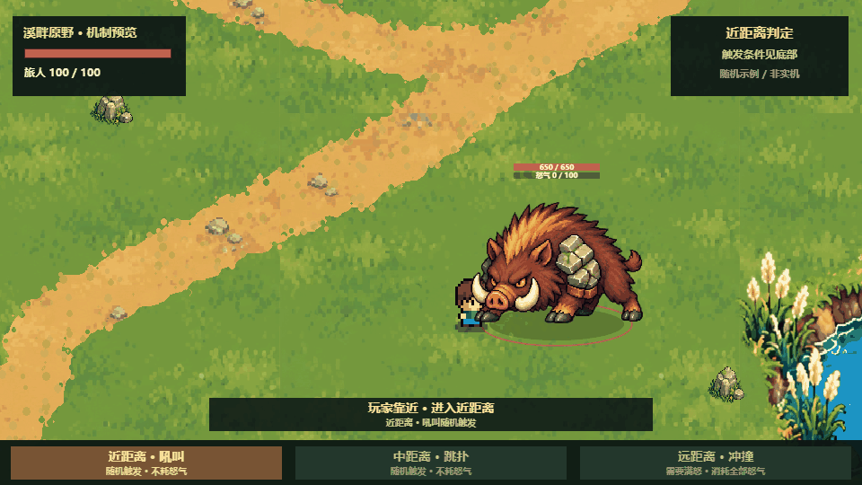
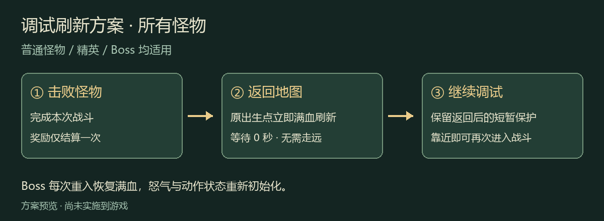
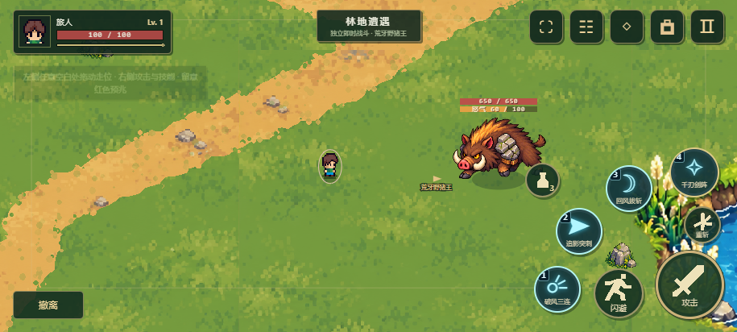

# 荒牙野猪王 · 最终技能演示

此 GIF 用于介绍 Boss、设计交接和后续开发参考。采用已确认的逐帧动作，以及“无头顶名字、无外围黑框，仅跟随血条和怒气条”的最终展示样式。

## 演示内容

| 时间 | 场景 | 介绍重点 |
| --- | --- | --- |
| 0–5 秒 | 近距离吼叫 | 玩家靠近后随机判定；未触发时等待，触发后抬头吼叫，造成近身范围伤害 |
| 5–11 秒 | 中距离跳扑 | 随机判定后压身、腾空扑向锁定落点，玩家侧向闪避，落地后可反击 |
| 11–24 秒 | 远距离怒气冲撞 | 怒气未满时不冲撞；满怒后跺脚两次、锁定方向、低头冲撞，清空怒气并喘息 |

怒气自然缓慢增长，受击时快速增加。两条进度条随 Boss 移动和跳跃；画面底部说明各距离的触发条件。

这是固定时间线的技能说明动画，用于清楚展示随机未触发与触发、命中与闪避等情形。实际游戏按玩家距离、随机判定和怒气状态运行。

## 文件与维护

- 文件：`skills-demo.gif`，24 秒循环，960×540，20 FPS 的源时间线。
- 归档日期：2026-10-30；技能机制沿用 `v2026.10.30.4`，展示基准已更新为 `v2026.10.30.8`，演示采用手机紧凑双条（96px）。
- 详细机制：[野猪王战斗说明](../../../野猪王战斗.md)。
- 默认规范：[Boss 规则](../../../Boss规则.md)。
- 本目录不受 `previews/` 的 Git 忽略规则影响，可随项目一并纳入版本管理；归档文件并不代表已经执行 Git 提交或线上发布。
- 后续更改已确认技能、动作或展示方式时，同步更新本 GIF 和本说明，使此处始终保留可直接用于介绍的最终版。不要只把新版放到临时预览目录。

## 调试刷新规则 · v2026.10.30.6

普通怪物、精英和 Boss 均在胜利后返回地图时，立即于原出生点满血刷新，无需等待或远离。返回后的短暂遇敌保护保留；Boss 每次重入重置怒气和动作，奖励仍按每次胜利结算一次。此方案已确认并实施。技能动作和伤害时机沿用原机制；头顶展示已按下方紧凑尺寸更新，上方技能 GIF 已同步重制。

## 紧凑双条 · v2026.10.30.8

Boss 桌面双条宽 120px，生命条高 10px、怒气条高 8px；手机双条宽 96px，生命条高 8px、怒气条高 7px，间隔 2px。保留生命与怒气数值、随移动和跳跃跟随，不增加头顶名称或外围黑框。技能 GIF 已同步为 96px 双条，原有 24 秒技能时间线和攻击机制保持一致。小怪另用桌面 72px、手机 56px 的单生命条。
