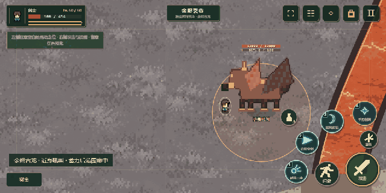

# 余烬古龙 · 技能演示

适用版本：v2026.11.01.1。此 GIF 由游戏实际渲染帧录制，演示角色使用无敌调试保护，未修改首领正式参数。

| 时间 | 技能过程 |
| --- | --- |
| 0–2.375 秒 | 近身吼叫：抬头蓄力 0.6 秒后造成范围伤害，单次命中。 |
| 2.375–4.875 秒 | 中距离跳扑：蓄力、锁定落点、腾空、落地及收势。 |
| 4.875–9.25 秒 | 满怒冲撞：跺脚蓄力、最后阶段锁向、冲撞消耗怒气、喘息反击窗口。 |

继承[Boss 规则](../../../Boss规则.md)的距离判定、独立怒气、单次伤害、预警和打断结构；攻击伤害按本区域数值缩放。头顶双条仅在战斗中展示，并跟随腾空高度。新首领使用独立的像素肢体和姿态绘制，未替换野猪王原图集。

录制来源：`tools/capture-rpg-bosses.mjs`；编码：`tools/encode-rpg-bosses.py`。逐帧状态见 [skills-demo.json](skills-demo.json)。总介绍见[六章冒险](../../../六章冒险.md)。
