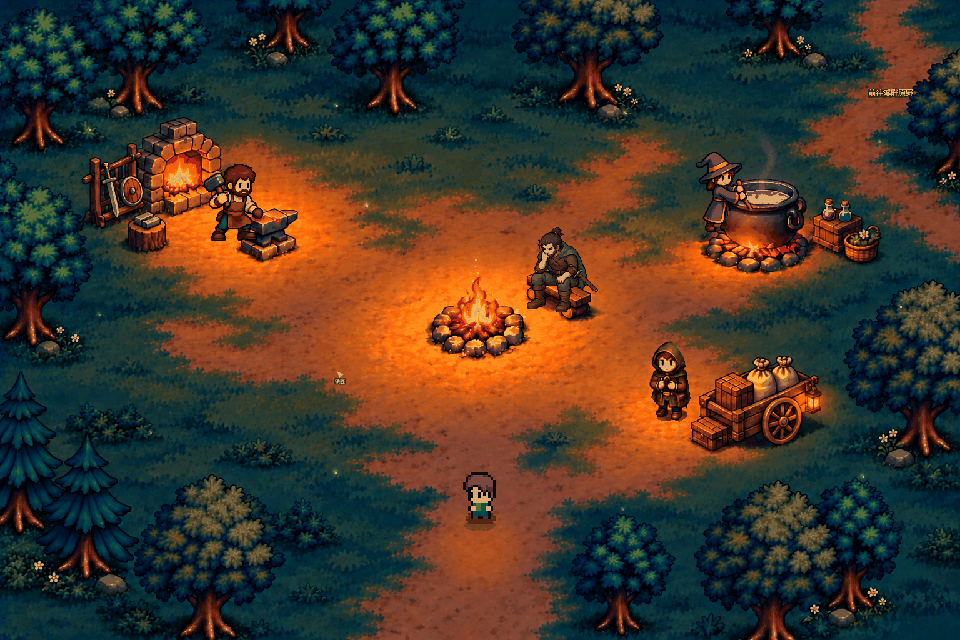

# 夜间营地与人物动作 · v2026.11.01.3

最终确认：三处露天服务、中央火堆、少量景物与萤火虫。铁匠合并武器、防具与锻造，巫师在大铁锅搅药，杂货商使用小货车。

剑客采用最终确认的旧皮甲、灰绿披风、朴素佩剑和克制像素五官。一手扶颌、一手搭膝，双脚自然垂下；八帧表现慢呼吸、垂首停顿和轻微抬眼，不双手合十。

实机动态（游戏渲染器录制，含原有可操作玩家）：

实机使用独立透明景物、可复用地表和逐帧人物，沿用原有玩家模型、成长、存档与服务规则。验证与构建方法见 [城镇说明](../../../城镇中心.md)。

早期设计演示仅作历史保留，内含此前长袍剑客造型：[旧营地预览](camp-actors.gif)、[旧人物特写](actor-details.gif)。当前剑客源图为 source-assets/town/camp-v1/hero.png，旧源图保存在 hero-wuxia-v1.png。
